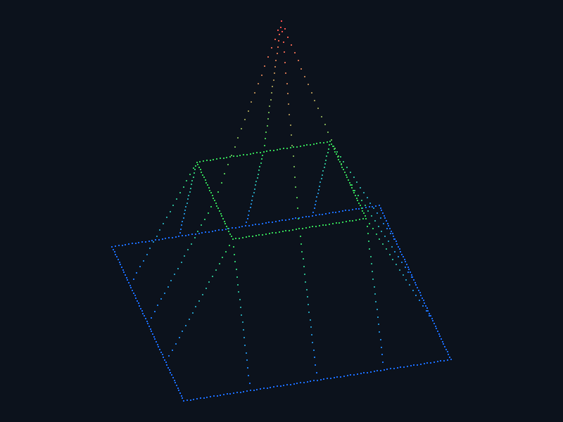
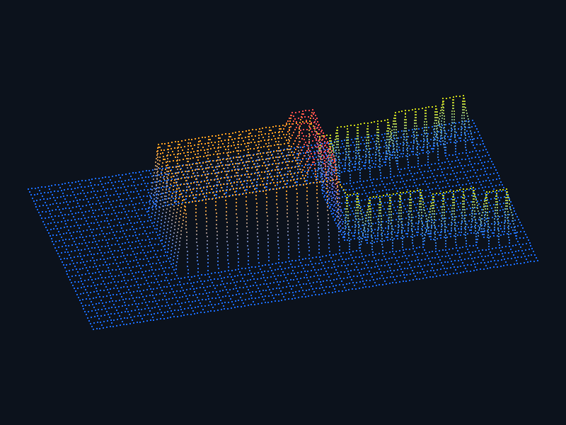

# FdF | каркасная карта высот

Python-приложение читает карту высот `.fdf` и показывает её как цветную каркасную модель в изометрической проекции.

<p align="center">
	<a href="docs/screenshot.png"></a>
	<a href="docs/cigarette_pack.png"></a>
</p>
<p align="center"><sub>Нажмите на изображение, чтобы открыть его в полном размере.</sub></p>

## Запуск

Нужен Python 3.12 или новее.

```powershell
python -m venv .venv
.\.venv\Scripts\Activate.ps1
python -m pip install -r requirements.txt
python main.py maps/elem.fdf
```

Для второй демонстрационной карты запустите `python main.py maps/cigarette_pack.fdf`.

## Управление

| Клавиша | Действие |
| --- | --- |
| `←` / `→` | Повернуть карту |
| `=` / `-` | Увеличить / уменьшить вертикальный масштаб |
| `V` | Переключить угол камеры между 0° и 30° |
| `Esc` | Закрыть окно |

## Формат карты

Каждая строка файла задаёт ряд точек. Позиция числа задаёт координату `x`, номер строки — `y`, число — высоту `z`. Строки должны быть одинаковой длины.

```text
0 0 0 0 0
0 2 2 2 0
0 2 5 2 0
0 2 2 2 0
0 0 0 0 0
```

Высоты могут быть отрицательными. Необязательный цвет задаётся после запятой, например `2,0xFF8800`.

## Структура

| Путь | Назначение |
| --- | --- |
| `main.py` | Запуск и сообщения об ошибках |
| `fdf/parser.py` | Чтение и проверка `.fdf` |
| `fdf/model.py` | Точки и сетка карты |
| `fdf/projection.py` | Проекция, масштабирование и цвета |
| `fdf/app.py` | Окно pygame, отрисовка и клавиши |
| `maps/` | Примеры корректных и некорректных карт |
| `tests/` | Модульные и публичные тесты |

## Проверки

```powershell
python -m pytest -q
mypy --strict fdf main.py
ruff check .
```

Снимки приложения можно пересоздать командой `python make_screenshot.py`.

## Лицензия

MIT
